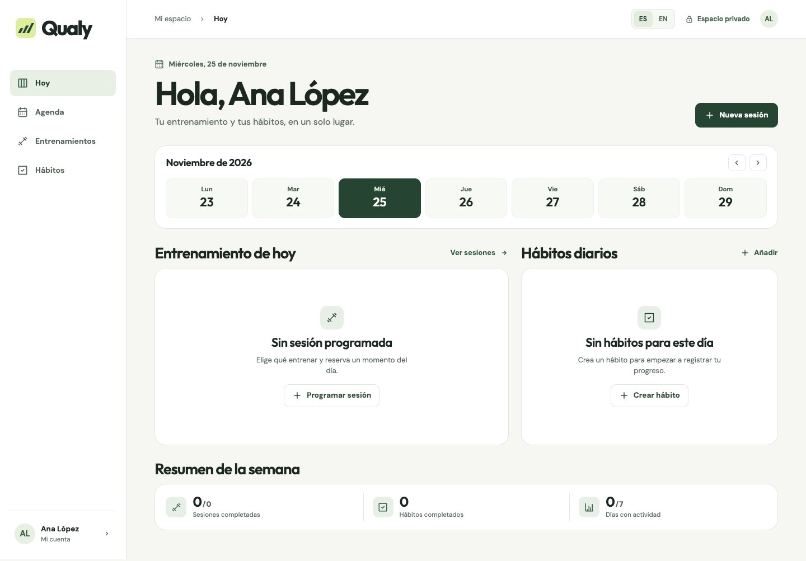

# Qualy

Qualy reúne tu agenda de entrenamientos y tus hábitos. En **Hoy** puedes ver qué tienes programado, a qué hora entrenas y qué hábitos te faltan por registrar.

## Empieza a usar Qualy

Selecciona **Crear cuenta** en la portada y regístrate con tu nombre, correo y una contraseña de al menos ocho caracteres que incluya un símbolo o un signo de puntuación. Tu agenda empieza vacía. Crea tus primeros entrenamientos y hábitos para organizar tu semana.

Si ya tienes una cuenta, selecciona **Iniciar sesión** y usa tu correo y contraseña para abrir tus registros.

## Planifica tus entrenamientos

En **Agenda**, elige un día y selecciona **Nueva sesión**. Define la hora y añade los ejercicios que vas a hacer. En cada ejercicio puedes indicar series, repeticiones y tiempo de descanso, además de guardar un enlace a un video.

En **Entrenamientos** puedes consultar tus sesiones pendientes y completadas. Abre una sesión para iniciar el temporizador de descanso o marcarla como completada.

## Registra tus hábitos

En **Hábitos**, selecciona **Agregar hábito** y elige cómo quieres registrarlo.

- **Fijo.** Márcalo como hecho cuando lo completes, por ejemplo, salir a caminar.
- **Con contador.** Define una meta diaria, por ejemplo, ocho vasos de agua. Usa **+** y **−** para ajustar la cantidad registrada.

Puedes cambiar el tipo de hábito, la meta o la unidad desde **Editar**. Si seleccionas **Quitar**, el hábito deja de aparecer desde ese día y conservas el historial anterior.

## Revisa tu progreso

Usa el calendario para consultar días anteriores. En **Resumen de la semana** puedes ver cuántas sesiones y hábitos completaste y cuántos días registraste actividad.

Puedes cambiar el idioma con **ES** o **EN** en la barra superior. La agenda usa la hora de Bogotá.
