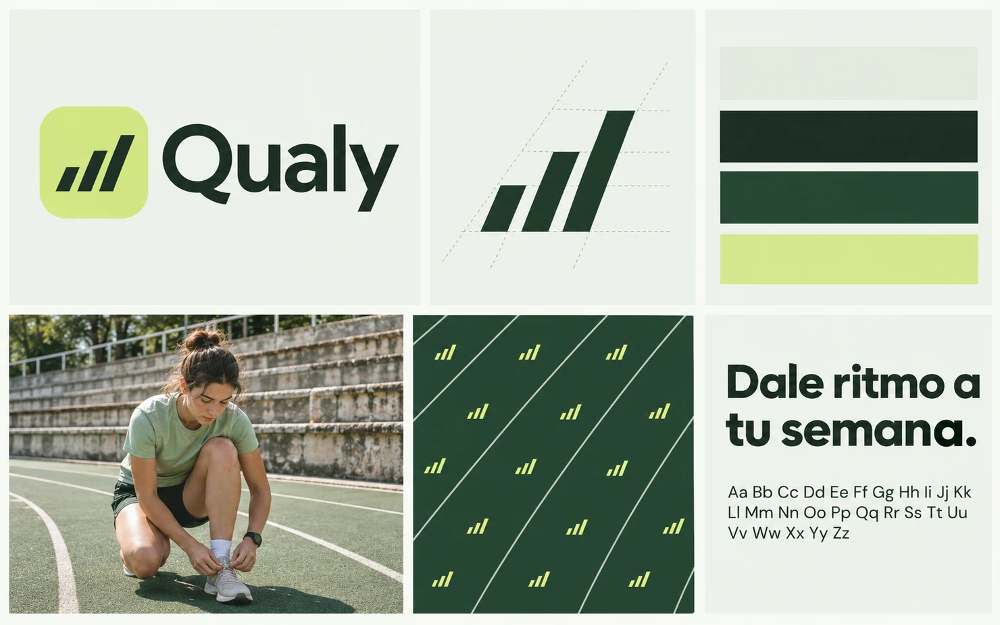

# Identidad de Qualy

Qualy reúne la agenda de entrenamiento y el registro de hábitos en un espacio personal. La marca se dirige a personas que quieren darle continuidad a su rutina y saber cómo les fue durante la semana. Su tono es cercano, concreto y tranquilo.

## Idea de marca

**Dale ritmo a tu semana.** La agenda da estructura, los registros hacen visible la constancia y la persona decide cómo avanzar. La versión inglesa del mensaje es **Find your weekly rhythm.**

El símbolo combina tres trazos diagonales de altura ascendente. Las marcas evocan un carril de entrenamiento y tres avances consecutivos. El logotipo reúne ese símbolo y el nombre Qualy en Outfit. Mantén un espacio libre mínimo de un cuarto del ancho del símbolo. En espacios pequeños, como el icono de pestaña, usa el símbolo solo.

## Color y tipografía

| Color | Valor | Uso |
| --- | --- | --- |
| Papel | `#F3F6EF` | Fondo de lectura |
| Tinta | `#1B2C22` | Titulares y texto principal |
| Bosque | `#244233` | Acción principal y fondo de cierre |
| Lima | `#DEEE9E` | Símbolo, marcas de avance y acciones sobre bosque |
| Texto secundario | `#4F6357` | Descripciones sobre papel |
| Blanco | `#FFFFFF` | Superficies de información sobre fotografía |

**Outfit** se usa en el nombre y los titulares. **DM Sans** se usa en el cuerpo, los controles y las cifras. Ambos tipos están alojados en el proyecto. Usa el texto en tinta o bosque cuando el fondo sea lima y conserva un indicador de foco visible en los controles.

## Patrón y composición

- Repite líneas diagonales a intervalos amplios, como las marcas de carril. En bloques de fondo, usa bosque con líneas tenues de lima. Reserva la trama para zonas de apoyo y deja espacio limpio alrededor de titulares y controles.
- Combina un titular amplio con fotografía editorial de rutinas cotidianas. Prioriza gestos reconocibles, luz natural y tonos verdes apagados. Identifica como ejemplo los datos ilustrativos que aparecen junto a una foto.
- Usa una retícula amplia y aire entre secciones. En pantallas estrechas, deja que la foto siga a las acciones principales y apila las explicaciones.
- Mantén una acción principal por bloque. **Probar la demo**, **Iniciar sesión** y **Crear cuenta** nombran acciones distintas. Describe lo que la persona puede hacer con la agenda y evita prometer resultados físicos.

## Aplicación

La landing usa el patrón en el bloque de cierre y presenta el producto con una escena de preparación para entrenar. El mismo símbolo aparece en la pestaña y en la navegación de la agenda.

La [fotografía de la portada](../public/assets/qualy-ritmo.webp) y el [tablero visual](qualy-tablero.webp) se generaron con ImageGen. El tablero sirve como muestra visual. Para reproducir los colores y la tipografía, usa los valores de esta guía.

Prompts de los recursos visuales

**Fotografía**

photorealistic-natural. Create one wide 4:3 premium editorial lifestyle photograph for Qualy, a bilingual workout and habit planner for ordinary active people. Scene: young adult female recreational runner with dark brown hair pulled back and medium brown skin, in an unbranded muted moss green quarter zip running top, slate navy shorts and off-white running sneakers. She is sitting on the edge of a pale sun-worn concrete bleacher, bending subtly forward lacing one shoe. Slightly elevated three-quarter camera, runner occupies central-right area, viewed from above enough to see both the runner and asphalt. The outdoor public running track is muted deep green with thin matte warm white lane markings running diagonally, hazy sunlit plants or trees in distant top corner, one discreet terracotta-orange reusable water bottle at bottom right near her, calm late-afternoon sunlight from upper left. Subject is shown head to toe in medium-wide environmental portrait, cropped none of the subject, with a quiet relatively empty lower-left area for a small UI overlay. The natural authentic moment of preparing for a daily routine, body proportions and hands realistic, athlete not posing at camera. Restrained warm film colors, natural contrast and lightly grainy contemporary lifestyle photography, no text, no logos, no frame, no interface, no typography, no collage.

**Tablero**

brand design identity board. Generate a polished one-page 16:10 landscape presentation board for the visual identity of Qualy, a bilingual personal workout and habit planner. The concept is rhythm through small daily repetitions, inspired by understated running-track markings and a paper training log. Quiet light greens style, generous margins, precise editorial alignment, no gradient shapes. Use a 2 by 3 panel grid with varied hierarchy: 1 left large cream-mint cover with the exact word 'Qualy' in contemporary geometric humanist sans, paired with the visual mark of THREE parallel short ascending diagonal bars of differing length arranged side by side, inside a rounded 12px chartreuse square, 2 graphic construction close up of the same 3 bars, 3 quiet small palette four flat rectangles: cream mint #F3F6EF, ink forest #1B2C22, deep green #244233, yellow lime #DEEE9E, 4 photo of a recreational runner on outdoor muted green track lacing their shoes by old concrete bleachers in natural sun, 5 dark green pattern sample derived from evenly spaced evocative running lane marks and brighter repetitive small three bar glyphs, 6 type panel with exact large Spanish text 'Dale ritmo a tu semana.' in display font in the style of Outfit and a small sample of DM Sans. Use only the text Qualy and Dale ritmo a tu semana, no other words or pseudo text or small labels. Keep the board restrained and coherent, designed like a thoughtful lifestyle brand for everyday training. No device mockup required. This is a conceptual preview alongside a separately specified production guide.

